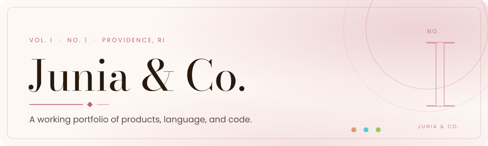

<!-- ═══════════════════════════════════════════════════════════════ -->
<!--   JUNIA & CO. · A WORKING PORTFOLIO                              -->
<!-- ═══════════════════════════════════════════════════════════════ -->

<picture>
  <source media="(prefers-color-scheme: dark)" srcset=".github/brand/banner-dark.svg">
  
</picture>

  

 

### · The Feature ·

# On building systems that *hold* people, not just process them.

> A Senior Data/AI/Risk Product Manager at Capital One. A REALTOR® at Corcoran. A founder of Age of Advocacy. A writer working in a language that doesn't exist yet.

Most of what lives in this profile is infrastructure. Repos that document how I think about data and decisioning at scale, how I audit products for equity gaps, how I use AI to compress the work that takes me from product manager to broker to teacher in a single day. The rest is curiosity, kept public so it stays honest.

| **16M+** | **30M+** | **4** | **2019** |
|:---:|:---:|:---:|:---:|
| Accounts at Cap One | Migration Scale | Working Languages | Age of Advocacy founded |

### · The Stack ·

### · Column One ·
## The Day Job

Senior Data/AI/Risk Product Manager at Capital One, and the authoritative source on income data collection and data strategy for U.S. Card. Every new-account and credit line increase application routes its income, housing, employment and asset data through my team's platforms. Currently leading the work to migrate 30M+ consumer accounts from Discover, and bringing generative AI into decisioning governance with human reviewers in the loop. The systems that decide whether a person can borrow, build, buy a home.

### · Column Two ·
## The Practice

Licensed REALTOR® with Corcoran Chart House Realty in Providence, serving Providence's Haitian, Dominican, and Caribbean communities in English, Haitian Creole, Spanish, and French. The thesis: technology and real estate are both about preserving space.

### · Column Three ·
## The Long Work

Age of Advocacy, the K-12 digital equity initiative founded in 2019, is the through-line. Responsible AI and technology policy are the long horizon. The same questions, just better tools to answer them.

### · The Works ·

| № | Repository | Description |
|---|---|---|
| **001** | [juniajanvier-site](https://github.com/juniajanvier/juniajanvier-site) | Personal site infrastructure for The Education Alchemist |
| **002** | [claude-tpm-copilot](https://github.com/juniajanvier/claude-tpm-copilot) | Product and program workflow tools and Claude skills |
| **003** | [equity-audit-toolkit](https://github.com/juniajanvier/equity-audit-toolkit) | Open framework for auditing products for equity gaps |
| **004** | [daily-dispatch](https://github.com/juniajanvier/daily-dispatch) | A small SMS service that texts you what you need to hear |
| **005** | [junia-gpt](https://github.com/juniajanvier/junia-gpt) | A custom assistant trained on context, voice, and brand |
| **006** | [junes-day](https://github.com/juniajanvier/junes-day) | A desktop companion that turns habits, tasks and focus time into a living scene |
| **007** | [life-tracker-automation](https://github.com/juniajanvier/life-tracker-automation) | Apps Script engine for a Google Sheets life and task tracker |
| **008** | [contact-cleanup-pipeline](https://github.com/juniajanvier/contact-cleanup-pipeline) | Finds stale, duplicate and unidentified contacts, privacy first |
| **009** | [photo-video-triage](https://github.com/juniajanvier/photo-video-triage) | Triage a huge photo library without moving or deleting a file |
| **010** | [common-ground-showcase](https://github.com/juniajanvier/common-ground-showcase) | A transparent, mobile-first directory of Black-owned businesses |

### · /now ·

*What I'm reading, building, writing.*

- **i.** Migrating 30M+ accounts from Discover at Capital One
- **ii.** Growing a real estate practice with Corcoran Chart House Realty in Providence
- **iii.** Open-sourcing the small tools that run my days, starting with June's Day
- **iv.** Writing an Afrofuturist novel in a constructed language
- **v.** Building this profile in public, slowly, honestly

  

